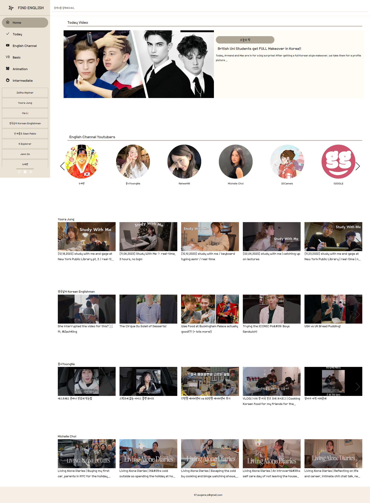
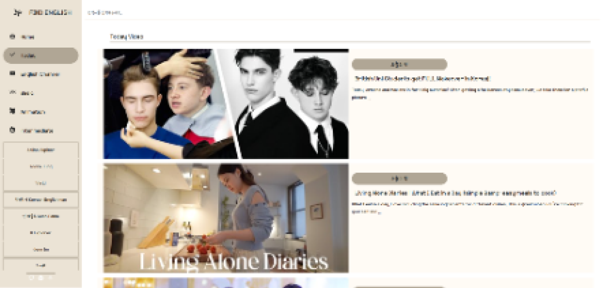
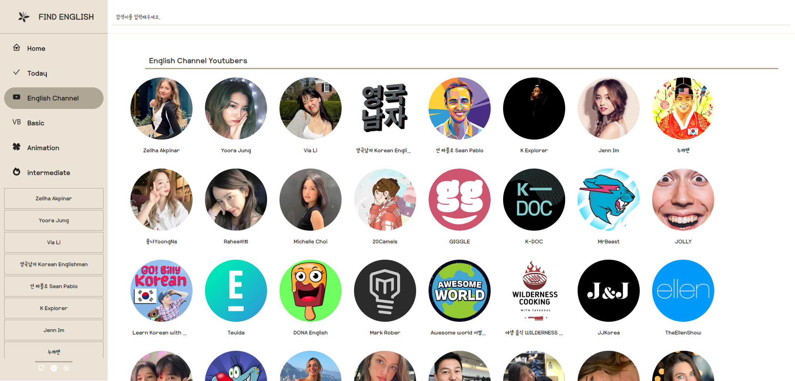
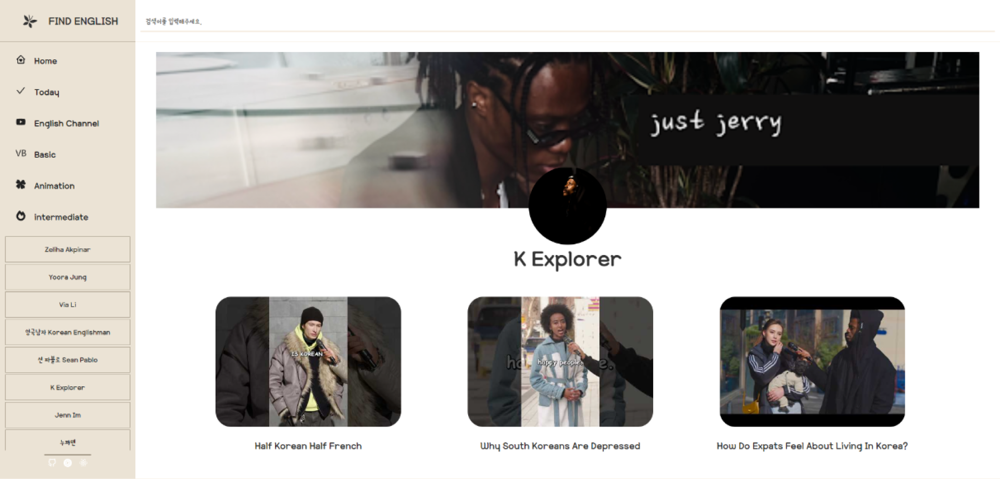
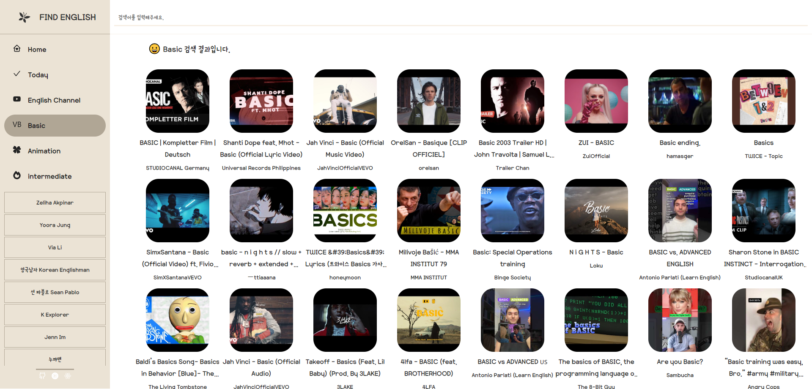
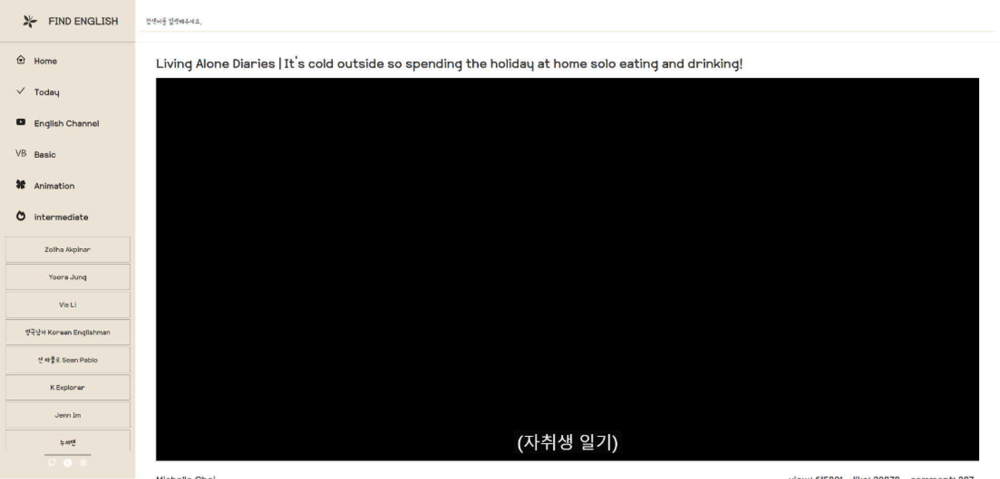

# Find English

> 영어 공부에 좋은 유튜브 채널과 영상을 골라 보여 주는 React 웹 서비스

**[포트폴리오](https://seoeugene.github.io)** · 배포: 준비 중 (API 키 문제로 현재 배포본 없음)

| 항목 | 내용 |
|---|---|
| 기간 | 2023.11 |
| 형태 | 개인 프로젝트 (공공 데이터를 활용한 Node.js 전문가 과정) |
| 역할 | 기획, 디자인, 개발 |

## 만든 이유
영어에 관심은 많지만 원어민 속도와 억양을 따라가기 어려운 사람을 위해, 한국어 자막이 있거나 한국계 크리에이터가 만든 영어 콘텐츠를 한곳에 모았습니다. 유튜브에서 직접 찾는 시간을 줄이는 것이 목표였습니다.

## 화면

| 메인 | 오늘의 영상 | 추천 유튜버 |
|---|---|---|
|  |  |  |

| 채널 | 검색 | 영상 재생 |
|---|---|---|
|  |  |  |

## 주요 기능
- **오늘의 영상·추천 유튜버**: 직접 고른 영상과 채널 목록을 보여 줍니다.
- **채널 페이지**: 채널 정보와 최신 영상 목록. 다음 페이지 토큰으로 영상을 더 불러옵니다.
- **검색**: 검색어로 영상을 찾고, 결과를 이어서 불러옵니다.
- **영상 페이지**: 영상 재생(react-player), 조회수 같은 통계, 댓글.
- **슬라이더**: Swiper로 채널별 최신 영상을 넘겨 봅니다.

## 기술 스택
| 구분 | 기술 |
|---|---|
| 프레임워크 | React 18, React Router |
| 통신 | axios, YouTube Data API v3 (RapidAPI) |
| UI | Swiper, react-player, react-icons, react-helmet-async |
| 스타일 | Sass (설정·섹션별 파일 분리) |

## 구조
```
src
├── pages        Home, Today, Youtuber, Channel, Search, Video
├── components   header, section, contents, video
├── data         오늘의 영상·추천 유튜버·메뉴 데이터
├── utils        api.js (RapidAPI 호출), scrollTo.js
└── assets/scss  setting, section
```

## 실행 방법
```bash
npm install
echo "REACT_APP_RAPID_API_KEY=발급받은_RapidAPI_키" > .env
npm start
```

## 돌아보며
- API 키를 환경 변수로 분리해 저장소에 올리지 않은 점은 잘했지만, 배포 환경에 키를 넣는 단계에서 막혀 배포까지 마치지 못했습니다.
- 무료 API 호출 한도가 작아서, 지금이라면 자주 쓰는 목록은 서버에서 한 번 받아 캐시해 두고 화면은 그 결과를 쓰도록 만들겠습니다.

학습하면서 남긴 자세한 기록은 [docs/개발노트.md](docs/개발노트.md)에 있습니다.

---
2023년 교육 과정에서 만든 프로젝트이며, 2026년에 README를 정리했습니다.
